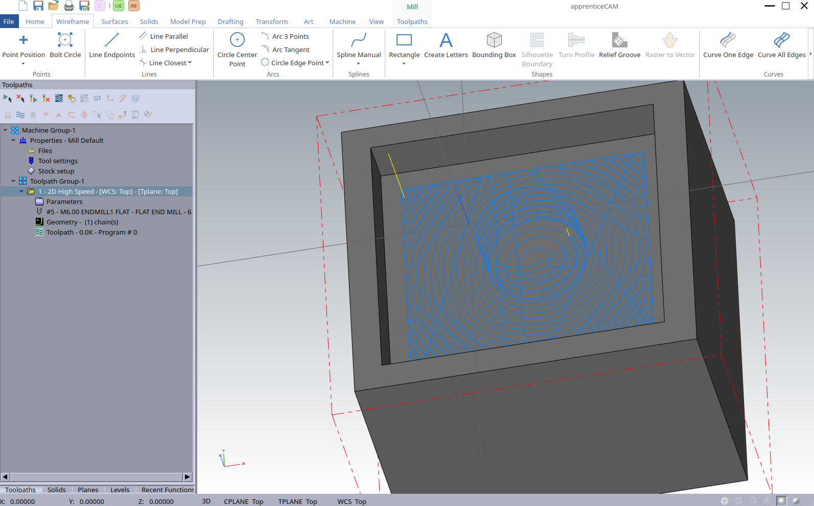
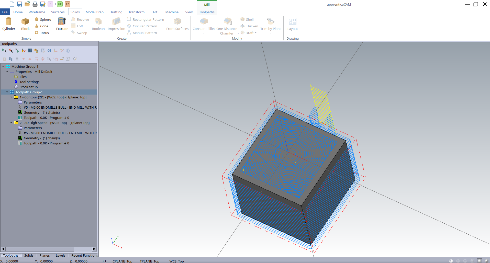
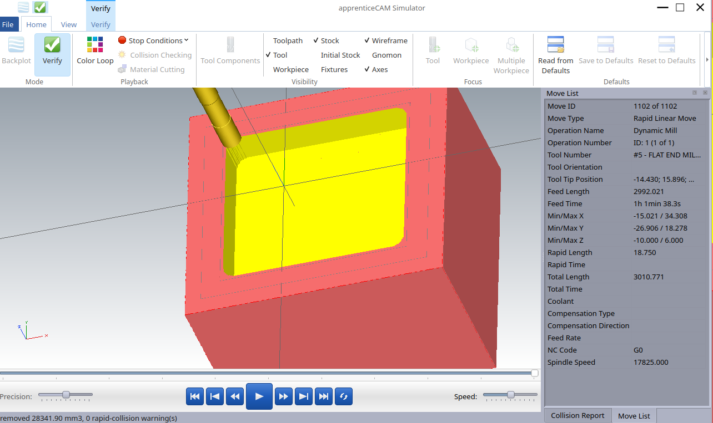
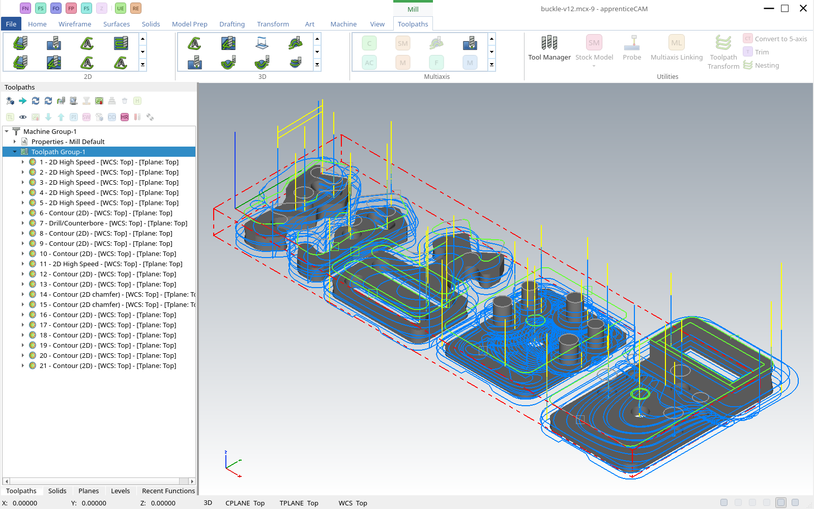

# apprenticeCAM

An experimental CAM workbench for Linux that reads and writes Mastercam 2017 / X9 part files (`.mcam`, `.mcx-9`),
regenerates and creates milling toolpaths, simulates them (backplot) and posts them for LinuxCNC. It is a
reimplementation written from reverse-engineering notes (`formats/`). It is not Mastercam and is not affiliated with or
endorsed by CNC Software, Inc. It ships no Mastercam files, tool libraries or part files, and no icons other than the
open-source stand-ins in `viewer-qt/icons_oss`.

What the code is:
- `viewer/` (C core: part-file reader / writer, toolpath engines, post, backplot, tools) and `viewer-qt/` (the Qt 6 user
  interface) are written by hand from the specifications in `formats/`, which describe Mastercam's file formats and
  behaviour as decoded from its program files (function addresses are cited throughout).
- `viewer/nest/ts/` is different: the TrueShape nesting engine is a machine translation, generated by
  `viewer/nest/ts/gen/gen.py` from the decompile of `n64dll.dll` (the NestLib nesting engine Mastercam ships), plus its
  data section (`ts_data.c`).

| 2D High Speed in a pocket | Contour + 2D High Speed around a block |
|---|---|
|  |  |
| **Verify: the simulator after the cut, with the move list** | **A multi-part job: every operation's toolpath** |
|  |  |

The first three screenshots show the app with the icon pack built from the author's own Mastercam installation
(`tools/setup_from_install.py`); without one, the buttons show the open-source stand-in icons, as in the fourth.

> **Warning.** This is unfinished, unverified software. Toolpaths, G-code and part files it produces may be wrong
> (depths, heights, rapids through stock, tool numbers, anything). Never run its output on a machine without
> verifying it yourself. Read the warning in [LICENSE](LICENSE); the program asks you to accept it at every start.

## License
MIT - see [LICENSE](LICENSE) (with the use-at-your-own-risk warning). Bundled third-party code and data:
`viewer/vendor/clipper6` (Clipper 6.2.0, Boost Software License), `viewer-qt/fonts/tahoma.ttf` (Wine's Tahoma,
LGPL-2.1-or-later, see `viewer-qt/fonts/README.md`), `viewer-qt/icons_oss` (stand-in icons from FreeCAD, LGPL, and SolidCraft, MIT / Apache-2.0; see its `LICENSES.txt`). The build downloads
SARibbon and Qt Advanced Docking System (LGPL-2.1) and links Qt 6 (LGPL-3).

## Building (Linux)
```
./install_deps.sh        # the packages for Debian / Ubuntu, Fedora, Arch, openSUSE (asks for sudo); --minimal skips the optional ones
./build.sh               # C core + command-line tools + the Qt app; ./build.sh clean for a fresh build, -j N for parallel jobs
viewer-qt/build/apprenticecam [PART.mcam|PART.mcx-9]
```
Requirements (what `install_deps.sh` installs): a C11 / C++17 compiler, make, CMake >= 3.21, git, Qt >= 6.6 (Widgets, OpenGL,
OpenGLWidgets, Svg and the private GUI headers), OpenGL / EGL, GLEW, SQLite 3. Optional: OpenCASCADE (3D toolpaths and
solid import; without it these commands are refused) and SDL2 (`viewer/mcamview`). The first build needs network access
(CMake fetches SARibbon and Qt-ADS). Distributions with an older Qt (Debian 12, Ubuntu 22.04 / 24.04: Qt 6.2 - 6.4) build
the command-line tools only.

Command-line tools (built in `viewer/`): `cam_cli PART list | fileop ID | post OUT.nc` (regenerate / post a part's
operations), `tool_cli LIB.tooldb`, `xt2obj`, `nc_dev`. See `formats/program_structure.md`.

## Mastercam data (optional)
Optional, from your own Mastercam 2017 copy (DVD .iso, its .msi or the program folder; needs 7-Zip and Pillow, which
`install_deps.sh` installs): `python3 tools/setup_from_install.py SOURCE` (Mastercam's icons, ribbon layout and the drafting /
letter stroke fonts into `~/.config/mcamui`), `python3 tools/import_libraries.py SOURCE` (tool, operation-defaults and
material libraries into `~/.config/mcamui/shared`). These scripts copy from your installation; the repository ships none of it.

Without data from your own Mastercam installation the program starts with an empty part and no default operations or tool
libraries. Its buttons use the bundled open-source stand-in icons (`viewer-qt/icons_oss`: FreeCAD, LGPL; SolidCraft, MIT /
Apache-2.0; sources and licences per file in its `LICENSES.txt`), and a letter tile where no stand-in is mapped. Point it at your own Mastercam folders with `~/.config/mcamui/paths.conf`
(example: `viewer/paths.conf.example`): `shared` (tool libraries, operation defaults), `user` (your CONFIG / keymap),
`schema` (Parasolid schema files), `fonts` (Mastercam's stroke fonts: Drafting and Create Letters need them).

## Documentation
- `viewer/README.md` - user guide (workbench, toolpaths, tools, files).
- `formats/README.md` - index of the specifications: file formats and Mastercam behaviour decoded per area.
- `formats/program_structure.md` - programs, source files, data model, this program's own file formats.
- `formats/provenance_audit.md` - what is decoded, what is our own, what is not decoded.
- `NOTES.md`, `formats/TODO.md`, `formats/user_decisions.md` - the working notes. They name test scripts, reverse-
  engineering tools and test parts that are not part of this repository; local paths are shown as `<repo>`,
  `<user-parts>`, `<windows>`, `~/mastercam-re/...`.
